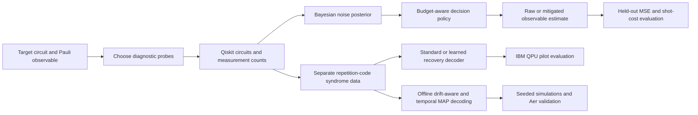

<div align="center">

# Quantum Bloom

### Q-TRACE — Uncertainty-Aware Quantum Noise Diagnosis, Mitigation & Recovery

**VTU-QFF-HC-0160**  |  Tier: **Online**

**Track 3 — Quantum Hardware & Error Correction**

</div>

---

<div align="center">

| | |
| :--- | :--- |
| **Team** | Quantum Bloom |
| **Team ID** | VTU-QFF-HC-0160 |
| **Tier** | Online |
| **Repository** | [vtu-hc-quantum-bloom](https://github.com/vtu-qiskit-fall-fest-2026/vtu-hc-quantum-bloom) |
| **Organisation** | [vtu-qiskit-fall-fest-2026](https://github.com/vtu-qiskit-fall-fest-2026) |
| **Event** | VTU-QFF Hackathon — VTU-Qiskit Fall Fest 2026 |

</div>

---

## 📌 Table of Contents

- [Team Members](#-team-members-github-ids)
- [Problem Statement](#-problem-statement)
- [Proposed Solution](#-proposed-solution)
- [Approach & Architecture](#-approach--architecture)
- [Tech Stack](#-tech-stack)
- [Project Structure](#-project-structure)
- [Installable Core & Validation](#-installable-core--validation)
- [How to Run](#-how-to-run)
- [How to Push Code](#-how-to-push-code)
- [Release & Submission Checklist](#-release--submission-checklist)
- [Resources](#-resources)
- [License](#-license)

---

## 👥 Team Members (GitHub IDs)

Quantum Bloom is a solo-entry team. The project is developed and evaluated within the online tier.

| # | Name | GitHub Username | Role |
| :-- | :--- | :--- | :--- |
| 1 | Đặng Vân Trang | [@trangetdua](https://github.com/trangetdua) | Team Lead · Research & Software Development |

---

## ❓ Problem Statement

**Problem:** Near-term quantum computation is sensitive to stochastic Pauli faults, imperfect measurements, and changes in device noise. With limited measurement shots, acquiring more diagnostic information can improve noise characterization but leaves fewer shots for estimating the observable that the experiment actually needs. A fault classifier can be accurate without improving the final computation.

**Why it matters:** Quantum software must decide **what to measure, when to stop calibrating, and whether acting on an uncertain noise estimate is worth the statistical cost**. An inaccurate or overconfident correction can increase mean squared error (MSE); spending too many shots on diagnostics can be equally harmful.

**Track / Category:** **Online · Track 3 — Quantum Hardware & Error Correction**. Q-TRACE's primary benchmark concerns **noise diagnosis and error mitigation**; the repetition-code experiments form a separate **quantum error-correction demonstrator**.

---

## 💡 Proposed Solution

**Solution:** **Q-TRACE** is a hybrid quantum–classical experimental framework that uses diagnostic measurements to characterize a restricted Pauli-noise model and makes shot-budget-aware decisions about observable estimation. It compares adaptive and fixed characterization, decides whether to mitigate an affected observable, and evaluates the outcome against raw measurements under equal **total** shot budgets. A separate hardware branch investigates syndrome measurement and recovery using a three-qubit repetition code.

**Key idea:** **Optimize the quality of the final quantum estimate—not merely fault-identification accuracy—by jointly accounting for diagnostic information, mitigation uncertainty, and remaining measurement shots.**

**Why this works:** For a stochastic Pauli fault, its effect on a measured Pauli observable depends on their commutation relation. The diagnostic posterior informs a predicted attenuation and the risk of using an inverse correction. Q-TRACE evaluates both the potential bias reduction and the additional variance of mitigation, including the opportunity cost of calibration shots.

### Experimental evidence

The **locked Aer benchmark** (`notebooks/20_locked_benchmark.py`) selects configurations using a separate validation split and evaluates them on held-out target and measurement seeds. It includes clean, 1%/3% readout-error, drift-up/down, and combined stress conditions.

| Total shots | Raw MSE ↓ | Fixed MSE ↓ | Adaptive MSE ↓ | Adaptive − fixed (95% bootstrap CI) |
| :---: | ---: | ---: | ---: | :--- |
| 128 | 0.025259 | 0.016806 | **0.016055** | **−0.000752** [−0.001071, −0.000443] |
| 512 | 0.021003 | **0.005174** | 0.005253 | +0.000079 [−0.000003, +0.000166] |

At **128 shots**, the adaptive configuration outperformed the validation-selected fixed baseline in this experimental distribution. At **512 shots**, the confidence interval overlaps zero, so this benchmark **does not establish an adaptive advantage**. The paired bootstrap resamples 48 target clusters and is conditional on the locked configurations; it is not a guarantee on arbitrary circuits or hardware.

**IBM Quantum hardware pilots:** The repetition-code experiments ran on `ibm_marrakesh` with controlled fault injection and natural device noise. In the **Mission 24** correlated-error pilot, `decoded_full_success` increased from **63.15% (standard decoder)** to **68.62% (calibration-learned decoder)**, with calibration shots recorded separately. This is a **single-calibration hardware pilot**, not an independently replicated performance claim or a fault-tolerance threshold demonstration.

**Scope and limitations:** The primary mitigation benchmark relies on a restricted stochastic Pauli model and simulated noise conditions. Hardware QEC results do not directly validate the simulator's mitigation claims. Q-TRACE does **not** claim quantum advantage, universal noise characterization, or a new quantum error-correcting code.

---

## 🧩 Approach & Architecture



1. **Input** — A target quantum circuit, Pauli observable(s), candidate single-Pauli fault models and a total measurement-shot budget. Hardware QEC experiments instead use encoded input states, controlled fault patterns and measured syndromes.

2. **Preprocessing** — Construct informative Pauli probes, compute fault signatures or observable attenuation, and define validation/test splits and measurement budgets before evaluation.

3. **Quantum core** — Generate and sample circuits with Qiskit Aer; use Statevector/Pauli analysis to verify observable relationships. The hardware branch uses a three-data-qubit repetition code, two syndrome ancillas, dynamic-circuit recovery and `SamplerV2` on IBM Quantum.

4. **Post-processing** — Update uncertainty over the noise model, compare fixed and adaptive calibration policies, decide whether mitigation is worth its expected MSE, and decode syndromes using a standard or calibration-learned lookup table where applicable.

5. **Output** — Observable estimates with **all diagnostic and application shots accounted for**, held-out MSE tables and confidence intervals, plus separate simulator/hardware recovery-success results and preserved experimental records.

**Reproducibility rules:** Held-out ideal expectations are used **only to score** estimates, not to select mitigation actions. Calibration and application shots are both charged to the total budget; refusing mitigation returns a raw estimate rather than removing the case. Calibration transfer initially assumes a sufficiently stable noise model; readout error and drift are investigated as stress tests.

---

## 🛠️ Tech Stack

| Layer | Technology |
| :--- | :--- |
| Language | Python 3.11 (tested IBM environment: 3.11.17) |
| Quantum SDK | Qiskit 2.6.1, Qiskit Aer 0.18.0, Qiskit IBM Runtime 0.51.0 |
| Inference & decisions | Bayesian updates, binomial likelihoods, posterior-risk minimization and dynamic programming |
| Simulation | Qiskit AerSimulator, Statevector, Pauli operators, configurable readout/noise stress tests |
| Real quantum hardware | IBM Quantum Platform, `SamplerV2`, dynamic circuits, `ibm_marrakesh` pilot |
| Data & analysis | NumPy, SciPy, pandas, Matplotlib; CSV/JSON/QPY artifacts |
| Development | VS Code, `venv`, Git + GitHub |

---

## 📁 Project Structure

```text
vtu-hc-quantum-bloom/
├── README.md                          # Methods, evidence, reproduction guide
├── pyproject.toml                     # Installable package and dependency metadata
├── requirements.txt                   # -e .[experiments,dev]
├── .gitignore
├── LICENSE
├── src/qtrace/                        # Reusable, installable Python core
│   ├── diagnosis/                     # Pauli signatures and Bayesian inference
│   │   ├── pauli.py
│   │   └── bayesian.py
│   ├── policies/                      # Stopping and mitigation decisions
│   │   ├── stopping.py
│   │   └── mitigation.py
│   ├── qec/                           # Repetition code and recovery decoders
│   │   ├── repetition.py
│   │   ├── decoder.py
│   │   ├── decoder_policies.py
│   │   ├── drift.py
│   │   ├── drift_policies.py
│   │   └── temporal.py
│   └── evaluation/
│       └── metrics.py
├── tests/                             # 62 Python unittest cases (Phase 10)
├── scripts/
│   └── final_audit.sh                 # 12-step offline integration audit
├── notebooks/                         # Numbered research experiments (.py)
│   ├── 19_dp_verification.py
│   ├── 20_locked_benchmark.py         # Main locked Aer mitigation benchmark
│   ├── 21_repetition_qec.py          # Repetition-code mechanism on Aer
│   ├── 24_learned_hardware.py        # Locked IBM hardware QEC pilot
│   ├── 27_decoder_generalization.py
│   ├── 28_guarded_decoder.py
│   ├── 29_cost_sensitive_decoder.py
│   ├── 31_policy_hardware.py         # Historical hardware policy protocol
│   └── 32_drift_aware_decoder.py     # Offline drift-aware benchmark
├── qec/
│   └── m33_repetition.py              # Temporal MAP simulation and Aer runner
└── results/                           # Preserved and curated experiment evidence
    ├── locked_benchmark_20/
    ├── matched_hardware_22/
    └── learned_hardware_24/
```

The full repository includes additional numbered research experiments. These are **Python scripts**, not Jupyter `.ipynb` notebooks. No `src/main.py` entry point is required for the current implementation.

---

## 📦 Installable Core & Validation

The refactored branch `refactor/qtrace-core` is an editable Python package. Reusable mathematical and decoding functions live under `src/qtrace/`; the numbered experiment scripts remain separate entry points so their protocols and recorded outputs can be audited independently.

The core modules cover Pauli diagnostics, Bayesian updating, shot-budget-aware stopping/mitigation, calibration-learned and guarded/cost-sensitive repetition-code decoding, Fisher-test-based drift monitoring, and multi-round temporal MAP decoding. The temporal decoder targets a **Z-basis logical bit** in a three-qubit X-noise repetition-memory model; it does **not** demonstrate arbitrary-state or fault-tolerant QEC.

**Validated refactor evidence (Python 3.11, local environment):**

- **62/62 unit tests passed** in a fresh virtual environment installed using `pip install -r requirements.txt`.
- **12/12 integration audit commands completed** with `scripts/final_audit.sh`, including local Qiskit Aer tests; no IBM QPU jobs were submitted by the audit.
- Pre/post-refactor deterministic comparisons preserved the selected numerical outputs from M20, M21, M28, M29, M32 and M33. For M33, the MAP lookup snapshots, seeded simulation CSV files and local Aer output were identical.

These checks establish the tested refactor's consistency, not an across-hardware performance or fault-tolerance guarantee. Original source-hash locks, job identifiers, protocols and published hardware artifacts are **historical provenance**: do not silently overwrite, rehash, or resume old hardware jobs with modified scripts.

---

## 🚀 How to Run

### Prerequisites

- Python **3.11** (the validated development and clean-install environment)

- [Git](https://git-scm.com/downloads)

- Internet access only for cloning/dependencies and **optional** IBM QPU operations

- An IBM Quantum account and authorized instance **only if submitting real hardware jobs**; **no token** is required for local Aer tests

### 1. Clone the repository

```bash
git clone https://github.com/vtu-qiskit-fall-fest-2026/vtu-hc-quantum-bloom.git
cd vtu-hc-quantum-bloom
```

The current refactor is on the `refactor/qtrace-core` branch, so until it has been merged, run:

```bash
git fetch origin
git switch refactor/qtrace-core
```

Keep existing experiment evidence on `main` intact; this README describes the refactored branch.

### 2. Create a virtual environment

```bash
python3.11 -m venv .venv-ibm
source .venv-ibm/bin/activate       # Linux / macOS
# .venv-ibm\Scripts\Activate.ps1  # Windows PowerShell
python -c 'import sys, ssl; print(sys.version); print(ssl.OPENSSL_VERSION)'
```

### 3. Install dependencies

```bash
python -m pip install --upgrade pip
python -m pip install -r requirements.txt
```

`requirements.txt` installs the editable package using `-e .[experiments,dev]`. Its direct requirements are defined in `pyproject.toml` (Qiskit 2.6.1, Aer 0.18.0, IBM Runtime 0.51.0 in the validated stack). Transitive dependencies are resolved by pip and are not yet frozen in an OS-independent lockfile. Check installation with:

```bash
python -m pip check
python -m unittest discover -s tests -p 'test_*.py' -v
```

### 4. Run

**Quick local smoke test (no IBM account needed):**

```bash
python notebooks/20_locked_benchmark.py --smoke \
  --output results/readme_smoke_20
```

**Reproduce the locked Aer benchmark (more computationally intensive):**

```bash
python notebooks/20_locked_benchmark.py \
  --backend aer --targets 48 --repeats 20 \
  --output results/readme_reproduction_20
```

**Repetition-code simulator test:**

```bash
python notebooks/21_repetition_qec.py --mode aer \
  --output results/readme_repetition_aer
```

Each run uses a **new output directory** because some scripts deliberately refuse to overwrite previous results. Compare outputs with the saved CSV/JSON evidence; small Monte Carlo differences are expected across experimental configurations.

**Real IBM hardware (optional):** Set up an IBM Quantum Platform API key securely **outside the repository**, check account/instance access, and run the `prepare` step of an experiment before choosing whether to `submit`. Hardware execution consumes QPU quota. For example, the existing matched-hardware workflow is implemented in `notebooks/22_matched_hardware.py` with `prepare`, `submit`, and `collect` actions; review the plan and backend compatibility before submitting. Do not place API credentials in source files or commits.

### 5. Run unit tests and the offline final audit

```bash
# Full unit suite: 62 tests in the validated Phase 10 environment
python -m unittest discover -s tests -p 'test_*.py' -v

# Local integration checks across selected missions; produces new /tmp output
bash scripts/final_audit.sh
```

The final audit checks packaging and M20/M21/M24/M27/M28/M29/M31/M32/M33 via small smoke runs or selftests. It does **not** re-run full research-scale statistical studies and does **not** submit hardware jobs. For standalone sanity checks:

```bash
python notebooks/24_learned_hardware.py selftest
python notebooks/31_policy_hardware.py selftest
python notebooks/32_drift_aware_decoder.py selftest
python qec/m33_repetition.py selftest
python qec/m33_repetition.py run-aer --rounds 3 --shots 128
```

M24/M31 hardware protocol files include source hashes; older runs must be interpreted with their recorded source versions and calibration locks. A passing selftest alone does not establish interchangeability with previously submitted IBM jobs.

---

## 🔁 How to Push Code

> Full walkthrough: [Git & Collaboration Handbook](../vtu-hc-guide-git-and-collaboration) — branch-based collaboration, pull requests, reviews and conflict resolution.

### Configure Git (first time only)

```bash
git config --global user.name  "Your Name"
git config --global user.email "you@example.com"
```

### Refactor branch workflow

Stage **only the source, package metadata, documentation, and audit script**, and inspect the staged patch before pushing. Preserve the curated historical artifacts in `results/` unchanged.

```bash
git branch --show-current          # expect refactor/qtrace-core
git status --short
git diff --check
git diff --name-status main -- results/

# Stage just Phase 10 files; stage earlier source-phase commits separately.
git add README.md pyproject.toml requirements.txt scripts/final_audit.sh
git diff --cached --stat
git diff --cached --check

git commit -m "chore: finalize Q-TRACE packaging and reproducibility audit"
git push -u origin refactor/qtrace-core
```

Review any changes under `results/` and any newly staged files before committing. Do not stage `.venv/`, `.venv-ibm/`, tokens, secrets, or generated data. The branch can be proposed for merge through a Pull Request after a provenance and content review; merging is **not** part of the offline audit.

### Commit message convention

| Prefix | Meaning |
| :--- | :--- |
| `feat:` | New feature |
| `fix:` | Bug fix |
| `docs:` | Documentation only |
| `test:` | Adding or fixing tests |
| `refactor:` | Code restructure, no behaviour change |
| `chore:` | Build/config/dependency changes |

### Useful commands

```bash
git status              # what changed
git log --oneline -10   # recent commits
git diff                # review unstaged changes
git diff --cached       # review staged changes
git stash               # temporarily shelve changes
git pull --rebase       # integrate remote changes when appropriate
```

### Collaborating on the same repo

- **Use feature branches and Pull Requests** rather than pushing unreviewed changes directly to `main`.

- **Pull before pushing** and inspect conflicts carefully.

- **Commit focused changes** that are reproducible and easy to review.

- **Preserve hardware job IDs, immutable calibration/test splits and protocol files** as experimental provenance; avoid replacing published results silently.

- **Check for leaked credentials and oversized files** before making the submission branch public.

---

## ✅ Release & Submission Checklist

- [x] Problem statement, evaluation protocol, limitations, and experimental evidence documented.
- [x] Qiskit 2.x-compatible editable package installed in a fresh Python 3.11 environment.
- [x] 62 unit tests and 12 local integration checks passed.
- [x] Virtual environments excluded by `.gitignore` (verify staged files before pushing).
- [ ] Replace and review `README.md` on `refactor/qtrace-core` with this updated version.
- [ ] Review `git diff --name-status main -- results/` and preserve historical hardware evidence and source-hash locks.
- [ ] Commit, push the refactor branch, and verify commands/links from the published branch.
- [ ] Decide separately whether to merge into `main`; review the reproducibility/provenance implications first.
- [ ] Verify any hackathon portal submission status independently; code audit does not submit to a portal.

---

## 📚 Resources

| Resource | Link |
| :--- | :--- |
| 🔁 Git & collaboration handbook | [Git & Collaboration Handbook](../vtu-hc-guide-git-and-collaboration) |
| ❓ Problem statements, solutions & terms | [Problem Statements, Solutions & Terms](../vtu-hc-guide-problem-and-solution) |
| 📄 README writing guide | [README Guide & Template](../vtu-hc-guide-readme-template) |
| ⚛️ Qiskit documentation | https://quantum.cloud.ibm.com/docs/ |
| ⚛️ Qiskit Runtime & primitives | https://quantum.cloud.ibm.com/docs/ |
| 🧪 Qiskit Aer simulator | https://qiskit.github.io/qiskit-aer/ |
| 💻 IBM Quantum Platform | https://quantum.cloud.ibm.com/ |
| 🎓 Qiskit learning | https://qiskit.qotlabs.org/learning/ |
| 📋 GitHub Docs | https://docs.github.com/ |
| 🔬 Repetition-code tutorial | https://quantum.cloud.ibm.com/docs/en/tutorials/repetition-codes |

---

## 📄 License

Released under the [MIT License](LICENSE). See `LICENSE` for details.

---

<div align="center">

**Quantum Bloom** · Team ID `VTU-QFF-HC-0160` · Tier `Online`

· Built with ⚛️ Qiskit for the VTU-QFF Hackathon

[⬆ Back to Top](#quantum-bloom)

</div>
